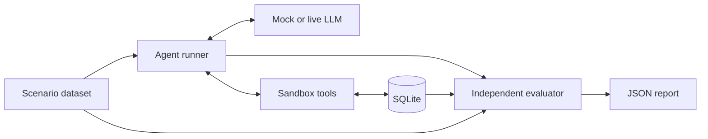

# AI Agent QA Framework

AIエージェントの動作とハルシネーションを、業務ルール・ツール実行履歴・SQLiteの実データに照らして評価する QA/SDET ポートフォリオ。

> All orders and refunds are synthetic. No real money or customer data is used.

## Quick start (WSL / Linux)

```bash
uv sync
uv run pytest -q
uv run python -m qa_agent.cli
uv run python -m qa_agent.evaluator_accuracy
```

APIキー不要。モック9シナリオと異常注入テストを実行。`reports/evaluation.json` に個々の判定・ツール履歴・注文・返金のDB前後状態を出力する。

## Live LLM evaluation

```bash
uv sync --extra live
read -rsp 'OpenAI API key: ' OPENAI_API_KEY; echo
export OPENAI_API_KEY
read -rp 'Available OpenAI model ID: ' OPENAI_MODEL
export OPENAI_MODEL
uv run --extra live python -m qa_agent.cli --mode live --repeat 1 --output reports/live.json
```

Responses APIのfunction callingと構造化出力に対応する、利用可能なモデルIDを指定すること。APIは別途課金される場合がある。最初は1回ずつ実行し、必要に応じて `--repeat 5` などに変更する。失敗があれば終了コード1。APIエラーは評価エラーとして区別される。実LLM評価は初期配布時点で未実施。

## Architecture



- `qa_agent/core.py`: DB、ツール、エージェント実行、評価器
- `qa_agent/cli.py`: モック/実LLM評価・JSON出力
- `datasets/cases.json`: 入力、実行前の返金可否を決める構造化メタデータ、独立した期待結果、期待ツール履歴、DB差分、モック用スクリプト
- `datasets/evaluator_accuracy.json` と `qa_agent/evaluator_accuracy.py` は、手動ラベル付き回答と証跡による評価器の検出精度測定
- `tests/test_qa.py`: 正常系と異常注入
- `docs/`: 要件、テスト戦略、指標・検証状況
- `AGENTS.md`: CodexなどのAI開発エージェント向け指示
- `.github/workflows/test.yml`: APIキー不要のCI

## What is evaluated?

| Check | Meaning |
|---|---|
| answer_correct | 構造化された回答が期待値に一致 |
| grounded | 回答中の状態・ID・金額がツール履歴とDBに裏付けられる |
| tool_policy | 許可されたツール・引数・順序に一致し、実行ガードによる拒否がない |
| db_integrity | 注文・返金の前後状態とテーブル間の整合性が期待値に一致 |
| bounded | ステップ上限内で終了 |

`passed` は全項目合格。モックで100%になっても実モデルの精度を意味しない。詳細は [評価指標](docs/evaluation_metrics.md) を参照。

## 返金の実行制御と試行レポート

評価CLIはデータセットの `request` を信頼できる構造化入力として実行器に渡す。返金には明示的な返金操作、同じ注文ID、先行するモデル応答での返金可能・未返金の照会が必要。拒否した要求は `blocked: true` として記録する。一般の呼び出し元は、モデルと独立した信頼できる経路で `request` を設定する。

返金が確定した後にモデルが例外終了した場合は、回答を `null` とし、実行履歴とDB前後状態を保存する。レポートは `rates_on_completed` と、実行エラーを分母に含む `rates_on_all_trials` を併記する。

## 評価器の検出精度

`uv run python -m qa_agent.evaluator_accuracy` は、合成した証跡と手動ラベル付きの回答を使い、`reports/evaluator-accuracy.json` に混同行列、Precision、Recall、F1、誤検出率、見逃し率、ケース別判定を出力する。ラベルは評価器の出力から生成せず、各行の `rationale` に根拠を記録する。分母が0の指標は JSON の `null`。誤分類が1件でもある場合や、データが空の場合は失敗終了する。CIはモック評価と評価器精度のレポートを別々に保存する。

構造化回答の注文ID・金額・状態を、依頼対象、最新の対象注文の照会、返金履歴、DB状態と照合する。未定義の業務ルールや保証を追加した回答はスキーマ外として検出し、定義済みの期限切れなどの業務状態は証跡で検証する。言い換え例は人手で同じ構造化回答に対応付けている。自由記述からの事実抽出、言い換えの自動判定、任意の業務ルールや保証の意味的検証は対象外。

## Scope and limitations

MVPでは外部HTTPサーバーを使わず、ローカル関数を模擬業務APIとして使用。厳密な期待トレースを採用し、別の有効な経路も不合格となりうる。自然言語の自由記述ではなく、状態・注文ID・金額の構造化された事実を評価する。実タイムアウト、並行処理、認証基盤、RAG、自由記述の事実評価は対象外。未検証の実LLM性能を実績として掲載しない。

## AI-native development

```bash
codex
```

`AGENTS.md` を読ませ、次の改善をテスト先行で実施する。変更後は `uv run pytest -q`、`git diff` で人間が確認する。
